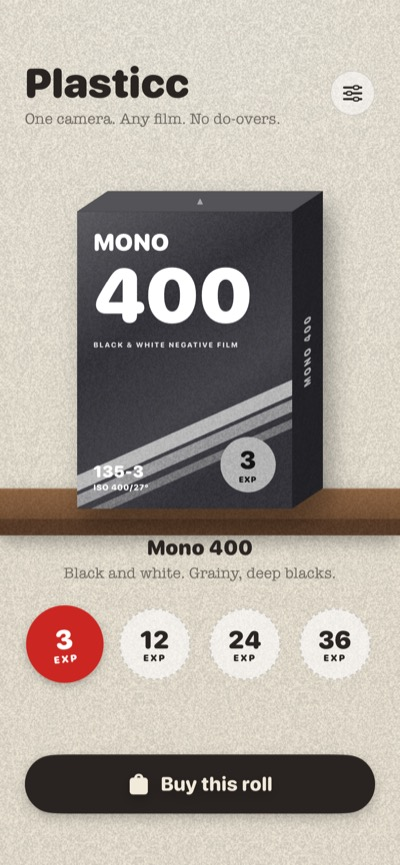
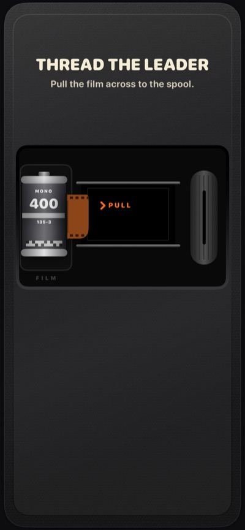
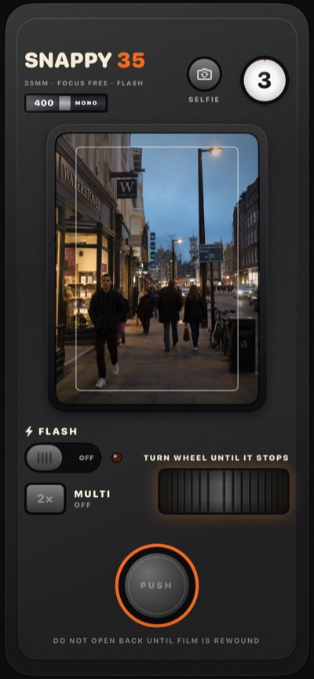
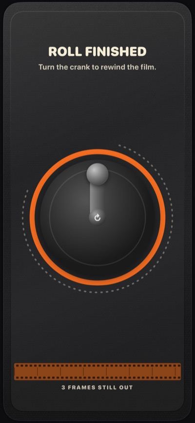
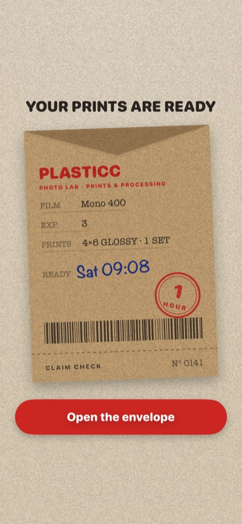
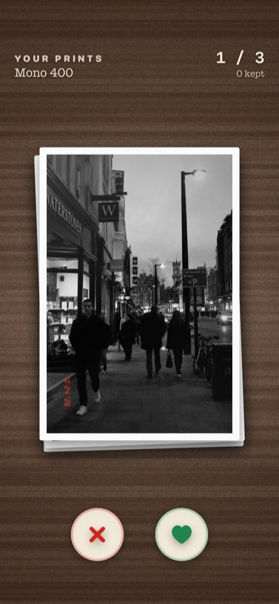

# Plasticc

An iPhone camera that feels like a single-use film camera. Buy a roll, load it, shoot blind, and wait for the lab.

<p>
  
  
  
  
  
  
</p>

## How it works

You keep one camera, the Snappy 35. The film is the thing you choose.

1. **Buy a roll** at the film counter: pick a film and 12, 24 or 36 exposures.
2. **Unbox it.** Lift the flap, pull the tube out and pop its lid.
3. **Load it.** Drop the canister into the chamber and pull the leader across to the spool. The back snaps shut.
4. **Shoot.** There's no preview of what you took, ever. Wind the wheel until it stops before each shot. You also get:
   - a flash switch that fires the iPhone's flash
   - MULTI, which lets you expose the same frame twice
   - a selfie camera
   - the volume buttons and Camera Control as a shutter
5. **Rewind** with the crank when the counter hits 0, then drag the canister into the lab envelope.
6. **Wait for the lab.** Prints come back instantly, in an hour or at 9 the next morning, as set in Settings. The timed options send a notification.
7. **Sort the prints.** Keep a print to save it to Photos, or toss it.

Each print gets the film's colour and grain, plus dust, a vignette, soft edges and the odd light leak. An orange date stamp sits in the corner. The lab crops prints to 3:2, 4:3 or 1:1. Saved prints carry EXIF tags: the camera reads as Plasticc Snappy 35, and the lens is the film's name.

Settings turn the date stamp, light leaks, glow and sounds on or off, and add two shortcuts that skip loading or developing.

## The films

| Film | Look |
|---|---|
| Verde 400 | Cool and punchy. Green shadows, bright blues. |
| Honey 400 | Warm and golden, with lovely blues. |
| Vivid 100 | Vivid. Deep reds, rich blues, fine grain. |
| Mono 400 | Black and white. Grainy, deep blacks. |

`docs/film-looks.md` covers how each look is modelled and tuned.

## Build and run

You need Xcode with the iOS 18 SDK and [XcodeGen](https://github.com/yonaskolb/XcodeGen). The app runs on iOS 18 and later, iPhone only, portrait only.

1. Generate the Xcode project from `project.yml`:

   ```sh
   xcodegen generate
   ```

2. Open `Plasticc.xcodeproj` and run the `Plasticc` scheme.

The simulator has no camera, so it shoots the sample photos in `App/Samples` instead.

To run on an iPhone, set your own team. Copy `Local.xcconfig.example` to `Local.xcconfig` in the repo root and put your team ID in it. `Local.xcconfig` is not committed. Also change the bundle identifier in `project.yml` before you build.

### Tests

The film engine, roll model and lab logic live in the `PlasticcCore` Swift package. It builds for macOS too, so the tests run without a simulator:

```sh
cd PlasticcCore && swift test
```

### Tools

- Develop photos with every film into one contact sheet:

  ```sh
  cd PlasticcCore && swift run -c release contact-sheet out.jpg photo.jpg …
  ```

- Rebuild the synthesised sounds in `App/Sounds`:

  ```sh
  python3 tools/make_sounds.py
  ```

- Redraw the app icon:

  ```sh
  swift tools/make_icon.swift App/Assets.xcassets/AppIcon.appiconset/icon.png
  ```

## Project layout

| Path | What's there |
|---|---|
| `App/` | The SwiftUI app, one folder per step: `Pick`, `Unbox`, `Shoot`, `Rewind`, `Lab`, `Review`, plus `Camera`, `Look`, `Feel` and `Settings` |
| `PlasticcCore/` | The Swift package: films, film engine, developer, roll model, and the `contact-sheet` tool |
| `tools/` | Scripts that make the icon and sounds |
| `docs/` | The plan, film-look notes and screenshots |
| `project.yml` | The XcodeGen project definition |
